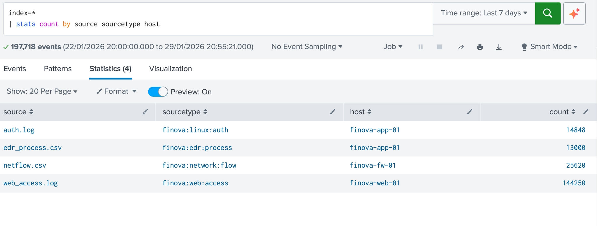

# Splunk SIEM Home Lab: Rule Detection & Alert Investigation

# I. Cài Splunk và Import log

[Pre-work_Handout_1_Cai_Splunk__Import_Data_(Optional).pdf](Pre-work_Handout_1_Cai_Splunk__Import_Data_(Optional).pdf)

- Dữ liệu:

[log-module-7-siem-rule-creation.zip](log-module-7-siem-rule-creation.zip)

## 1. **Mục tiêu**

Làm việc trực tiếp với dữ liệu log trên Splunk để:

- Quan sát hành vi từ log
- Viết các câu truy vấn SPL phục vụ detection
- Lưu truy vấn thành **Alert thực sự trong SIEM**
- Nhận diện các vấn đề khi detection được deploy
- Cải thiện detection thông qua:
    - Threshold
    - Whitelisting
    - Điều chỉnh logic & trade-off

## 2. **Bối cảnh hệ thống (System Context – FINOVA)**

FINOVA là một doanh nghiệp giả định với các hệ thống chính:

- **Web Server**: cung cấp dịch vụ web công khai
- **Application Server**: xử lý nghiệp vụ nội bộ
- **Linux Authentication**: SSH cho quản trị & vận hành
- **SIEM (Splunk)**: tập trung log để giám sát & phát hiện

Các loại log sẽ làm việc

| **Loại log** | **Mô tả** |
| --- | --- |
| Web Access Log | HTTP request, URL, status, user-agent |
| Auth Log | Login success / failure (SSH) |
| EDR / Process Log | Tiến trình tạo file, thực thi |
| Network / Netflow | Lưu lượng outbound, dung lượng |



# II. Rule Detection

# **USE CASE 1 – WEB ABUSE / SQL INJECTION**

---

## **1. Bài toán thực tế (Problem Framing)**

Team Web nói:

> "Không thấy website bị sập, nhưng trong log có vài request rất lạ.
> 

Điều này có nghĩa:

- Không phải **mass scan**
- Không phải **noise thông thường**
- Có thể là **attacker thử từng bước, né firewall**

👉 Đây là **loại tấn công nguy hiểm hơn scan** vì:

- Có chủ đích
- Ít ồn
- Dễ lọt qua rule đơn giản

---

## **2. SQL Injection**

Từ góc nhìn business:

- SQLi thành công = truy cập dữ liệu trái phép
- Dữ liệu có thể là Thông tin khách hàng, tài khoản nội bộ, các database quan trọng khác. Hậu quả có thể là mất dữ liệu - mất uy tín - rủi ro pháp lý.
- Và đôi khi một số cơ chế prevention chủ động chưa có, ứng dụng còn lỗ hổng này chưa kịp vá, thì việc chủ động làm rule detect sớm là việc nên làm.

---

## **3. Phân tích log**

### **3.1 Quan sát ban đầu (Exploration)**

Thường tìm xem nguồn truy cập từ đâu? Khai thác thử trường clientip

```
index=finova_web
| stats count by clientip
| sort -count
```


**Mục tiêu tư duy:**

- IP nào nổi bật? đó là các địa chỉ top 3 thực hiện gửi request nhiều nhất: 10.0.10.10, 45.77.88.201, 10.0.10.50. Thì lúc này có quyền nghi ngờ các địa chỉ IP này? question tại sao có nhiều web request như vậy, nhưng cũng không chắc đây là các IP của các attacker. IP top có thể là healthcheck, QC, hoặc scanner nội bộ
- Đây là traffic bình thường hay bất thường? Chưa kết luận được

Hoặc có thể khảo sát theo useragent, và các khảo sát khác để người làm rule có một số nhìn nhận ban đầu về log của một đợt tấn công, có thể chú ý vào các dữ liệu xuất hiện lần đầu, số lượng ít hẳn so với tổng thể. VD như bên dưới nhìn thấy useragent là sqlmap/1.7, python-request, curl,… thì cũng có thể nhận định có những thủ thuật khai thác với scripting, sqlmap đã nhắm vào ứng dụng web hiện tại. 


---

⇒ Ý chính của phần này là tạo thói quen cho học viên khám phá dữ liệu, rút ra insight và đưa ra một số nhận định ban đầu về một vấn đề cụ thể.

### **3.2 Thu hẹp vào hành vi SQL Injection (theo thông tin trình báo trước đó)**

Theo thông tin trình báo trước đó thì có một số request bất thường có dạng như câu lệnh SQL

Ở đây học viên tìm **web traffic theo ý đồ với các keyword của SQL Injection kinh điển**

💡 %27 = '

💡 OR 1=1 

(hoặc những keyword khác, học viên hoàn toàn có thể mở rộng)

```
index=finova_web 
| eval uri=urldecode(uri) 
| search uri="* OR*"
```

```latex
hoặc
index=finova_web
| eval uri=urldecode(uri)
| search uri="*' OR 1=1*"
```


---

Một số điểm cần chú ý/ rút ra sơ bộ từ hình trên:

- có 250 event ghi nhận log truy cập có URI chứa ký tự thể hiện tấn công SQL injection
- nhìn kỹ lại uri thì chỉ có một payload thôi (nếu có payload loãng khác bạn nhớ loại bỏ ra nhe)
- có 1 clientip 103.21.244.12 thực hiện các request này thôi

⇒ Nhưng mối quan tâm là không thể để các event thô như này (raw event) chạy ra 250 cảnh báo!

### **3.3 Gom hành vi theo nguồn (Behavior grouping)**

Khi này nhiệm vụ là phải xuất dữ liệu để trả lời: “Ai” thử SQL injection? Tức là chuyển từ event đơn lẻ sang behavior, mà behavior thì thường ít nhất chỉ ra được “ai” làm hành động gì.

```
index=finova_web 
| eval uri=urldecode(uri) 
| search uri="* OR*" 
| stats count by clientip
```


⇒ Như vậy thay vì chuẩn bị một detection ra 250 event thì giờ đây với statistic như trên, kết quả trả về chỉ còn 1 sự kiện thể hiện “client IP 103.21.244.12 thực hiện 250 lần request thử SQLi”

-cụ thể và ngắn gọn

---

### **3.4 Áp ngưỡng (Threshold)**

```
index=finova_web 
| eval uri=urldecode(uri) 
| search uri="* OR*" 
| stats count by clientip 
| where count > 5
```

Kết quả cũng ra như phần trên thôi, nhưng **Tại sao cần threshold?**

- 1 request:
    - Có thể là test
    - Có thể là dev debug
- 5–10 request:
    - Bắt đầu có **ý đồ**
    - Có **lặp lại**

Lưu ý là Threshold **không phải con số đúng/sai**, mà là **trade-off giữa bỏ sót và báo nhầm, và thể hiện mức độ bạn hiểu về business của mình (biết rằng đôi khi có những hành động test, đánh giá bảo mật thử,…) với một vài request.**

---

## **4. ALERT – Phiên bản đầu tiên (Naive Alert)**

### **4.1. Human-Readable Alert (bản lưu lại làm tài liệu, báo cáo)**

**Tên Alert**

> [Tên bạn] – UC1 – SQL Injection Attempt Detected
> 

**Mô tả**

> Phát hiện một địa chỉ IP gửi nhiều request chứa chuỗi SQL Injection tới website FINOVA trong thời gian ngắn.
> 

**Severity**

> Medium
> 

**4.2. Thực hiện save lại trên Splunk**


Như vậy học viên đã tạo được alert đầu tiên và có thể dự đoán được nếu trong tương lai, nếu có một IP X thực hiện request 30 lần trong vòng 15 phút với uri chứa ký tự “* OR *” thì sẽ được cảnh báo như sau

| **clientip** | **count** |
| --- | --- |
| X | 30 |

và đây cũng sẽ là thông tin mà các analyst sẽ tiếp nhận được **trong tương lai**.

---

## **5. PITFALL – Vấn đề của alert này là gì?**

Nếu chỉ dừng ở đây, alert này **có các vấn đề sau**:

### **5.1 False Positive**

- Dev test hệ thống
- QA test input
- Admin dùng tool kiểm tra

Có thể dẫn đến SOC sẽ **tốn thời gian xác minh vô ích**

---

### **5.2 SOC Fatigue**

- Alert này không nói phải làm gì tiếp theo, như vậy nó không phải là một actionable detection.
- Analyst phải:
    - Mở log
    - Tự suy luận
    - Tự quyết định

Alert có thể bị coi là **"nhiễu"**

---

### **5.3 Business impact chưa rõ**

Alert **không trả lời được**:

- Có cần block IP không?
- Có cần escalate không?
- Có cần thông báo team Web không?

---

## **6. CHALLENGE – Tuning Alert**

### **6.1 Loại trừ IP hợp lệ (Whitelisting)**

Ví dụ như bạn biết địa chỉ IP "10.0.10.10" từ team QC hoặc test bảo mật, hoàn toàn có thể loại trừ sớm để bớt nhiễu như sau 

```
index=finova_web NOT clientip="10.0.10.10"
| eval uri=urldecode(uri) 
| search uri="* OR*" 
| stats count by clientip 
| where count > 5
```

**Whitelisting giúp** alert **đáng tin hơn**

---

### **6.2 Phiên bản alert tốt hơn**

Bạn có thể lưu alert trên thành một phiên bản detection mới, kèm theo human readable như sau để tránh những pitfall nêu ra phía trên

**Tên Alert**

> [Tên bạn] – UC1 – Repeated SQL Injection Attempts from External IP
> 

**Mô tả**

> Một IP bên ngoài đang gửi nhiều request chứa mẫu SQL Injection tới website FINOVA, vượt ngưỡng thông thường. Cần xác minh và cân nhắc block nếu tiếp diễn.
> 

**Hành động SOC đề xuất**

- Kiểm tra IP reputation
- Theo dõi thêm 15 phút
- Block nếu tiếp tục

---

## **7. Common Mistakes & Why (UC1 – Chi tiết)**

Tóm lại

| **Sai lầm** | **Vì sao sai trong SOC** |
| --- | --- |
| Chỉ tìm keyword | Attacker biến thể payload |
| Không threshold | Alert bắn nhiều gây loãng |
| Không whitelist | SOC nhận nhiều alert và không tin vào độ chính xác của detection, mất thời gian  |
| Không action | Alert chỉ để ngắm |

Với use case 1, bài guideline đi qua chi tiết để học viên có thể thấy được quá trình phát triển một rule người detection engineer có luồng suy nghĩ như thế nào, quan tâm những mối quan tâm nào. Dường như các suy nghĩ và tư duy trên áp dụng cho mọi tình huống phát triển rule phát hiện các loại tấn công từ đơn giản đến phức tạp.

---

# **USE CASE 2 – SSH BRUTE FORCE**

---

## **1. Bài toán thực tế**

SOC thấy:

- Nhiều login fail
- Không biết là:
    - User quên mật khẩu
    - Hay attacker thử

Detection phải **phân biệt được 2 thứ này**

---

## **2. Phân tích từng bước**

### **2.1 Nhìn raw thất bại**

```
index=finova_auth Failed
```


⇒ Chưa kết luận được gì, chỉ có thể rút ra vài thông tin

- có các hành vi authenticate SSH (bằng mật khẩu) thất bại
- nhìn lên chart thì thấy khung 2 giờ sáng có số lượng Failed cao hơn bình thường

---

### **2.2 Gom theo hành vi**

**Truy vấn cơ bản**

```latex
index=finova_auth Failed 
| stats count by src_ip

hoặc

index=finova_auth result=Failed 
| stats count by src_ip
```

✍️ IP nào xuất hiện nhiều lần? đó là “45.77.88.201”


**Bước 2 – Gom theo hành vi** 

```
index=finova_auth Failed
| stats dc(user) as user_count by src_ip
| where user_count > 5
```

**Logic ở đây là gì? (giả định)**

- Người dùng thật:
    - 1 user
    - Nhiều fail
- Attacker:
    - 1 IP
    - Nhiều user

---

## **3. Alert v1**

**Mô tả**

> Một IP đang thử đăng nhập SSH với nhiều tài khoản khác nhau. Đây là dấu hiệu điển hình của brute force.
> 

**Severity**

> Medium → High nếu kéo dài
> 

Có thể lưu câu search ở bước 2 thành cảnh báo brute-force SSH

---

## **4. (Thảo luận thêm) SUCCESS AFTER FAILURE**

Nếu:

- Fail 10 lần
- Sau đó success 1 lần

⇒ Có nghĩa:

- Password **đã đúng**
- Tài khoản **đã bị compromise**

⇒ Đây là lúc **incident bắt đầu**, không phải kết thúc.

---

## **5. Góc nhìn Business**

- SSH compromise = quyền hệ thống
- Một server bị chiếm = bàn đạp lateral movement
- Detection trễ = thiệt hại dây chuyền

## 6. Cải tiến cảnh báo

Gợi ý SPL cải tiến để phát hiện SSH thành công sau hàng loạt failure như sau, dùng **transaction**

VD như bên dưới thực hiện loại trừ các địa chỉ IP local 10.*, gom nhóm theo src_ip và user trong vòng 10 phút, sau đó lọc lại các nhóm có kết quả authentication vừa Failed vừa Accepted (success)

```latex
index=finova_auth result=* NOT src_ip=10.*
| transaction src_ip user maxspan=10m
| search result=Failed result=Accepted
```

→ Tinh chỉnh lại để giữ những trường quan trọng

```latex
index=finova_auth result=* NOT src_ip=10.*
| transaction src_ip user maxspan=10m
| search result=Failed result=Accepted
| table _time result eventcount src_ip user host
```


---

---

# **USE CASE 3 – LOGIN NGOÀI GIỜ**

---

## **1. Bài toán thực tế (Problem Framing)**

SOC nhận được một alert:

> "User ketoan.nguyen đăng nhập SSH thành công lúc **02:15 sáng**"
> 

---

## **2. Tại sao Login ngoài giờ là Use Case quan trọng?**

Từ góc nhìn SOC & business:

- Trên thực tế Credential theft hoàn toàn có thể xảy ra, ví dụ admin bị phishing hoặc cài các stealer (học viên có thể tìm các stealer như Redline Stealer,… để tìm hiểu thêm) và chúng đánh cắp credential của admin. Cho nên với log đăng nhập bình thường cũng không hẳn cho chính admin thực hiện.
- Attacker dùng:
    - Password đúng
    - User thật
    - Hành vi giống người thật
    
    ⇒ Nếu SOC **chỉ dựa vào "fail / success"** thì không thể ra quyết định gì.
    

⇒ Vì vậy phải nhìn:

- **When** (thời gian)
- **Who** (user đó là ai)
- **Usual behavior** (bình thường user này hoạt động khi nào?)

---

## **3. Phân tích log**

### **3.1 Truy vấn login thành công**

```
index=finova_auth Accepted

hoặc 
index=finova_auth result=Accepted
```

Ở bước này:

- Không kết luận
- Chỉ xác nhận dữ liệu có tồn tại
- Bạn có thể dùng timechart để preview tần suất xuất hiện của các sự kiện này


---

### **3.2 Thêm yếu tố thời gian (Context)**

```
index=finova_auth result=Accepted
| eval hour=strftime(_time,"%H")
| where hour < 8 OR hour > 18
```

**Bạn đang làm gì ở đây?**

- Không kết luận user đó là attacker
- Chỉ nói: "Hành vi này xảy ra **ngoài giờ làm việc thông thường**"


---

## **4. ALERT – Phiên bản đầu tiên**

### **Human-Readable Alert**

**Tên Alert**

> [Tên bạn] – UC3 – Login Outside Working Hours
> 

**Mô tả**

> Phát hiện tài khoản đăng nhập thành công vào hệ thống FINOVA ngoài khung giờ làm việc tiêu chuẩn.
> 

**Severity**

> Low → Medium
> 

---

## **5. PITFALL – Alert này có vấn đề gì?**

### **5.1 False Positive cao**

Như khảo sát trên bạn có thể thấy có rất nhiều hành vi đăng nhập ngoài giờ, nếu xem kỹ thì hoàn toàn có thể vì những lý do bình thường sau, chứ không phải là một hành vi đáng ngờ

- Admin bảo trì ban đêm
- Nhân viên trực ca
- Deployment ngoài giờ

SOC sẽ:

- Ignore
- Auto-close
- Mất niềm tin vào alert

---

### **5.2 Thiếu ngữ cảnh con người**

Alert **không biết**:

- User này thuộc bộ phận nào?
- Có làm ca đêm không?
- Có từng login ngoài giờ trước đó không?

---

## **6. CHALLENGE – Tuning & Trade-off**

### **6.1 Whitelisting theo user / role**

Ví dụ (logic):

```
index=finova_auth result=Accepted
| eval hour=strftime(_time,"%H")
| where (hour < 8 OR hour > 18)
| search NOT user IN ("finova-admin","svc-backup")
```

---

## **7. Phiên bản alert cải tiến**

**Tên Alert**

> [Tên bạn] – UC3 – Unusual After-hours Login (Non-Admin User)
> 

**Mô tả**

> Một tài khoản người dùng thông thường đăng nhập thành công ngoài giờ làm việc. Cần xác minh với quản lý trực tiếp của user.
> 

**Hành động đề xuất**

- Xác minh với HR / Line manager
- Theo dõi hành vi tiếp theo của user
- Không block ngay

---

## **8. Góc nhìn Business**

- Đây **không phải alert để block**
- Đây là alert để:
    - **Xác minh con người**
    - **Ngăn incident sớm**
- Sai lầm lớn nhất:
    - Escalate quá mức → gây hoảng loạn
    - Ignore hoàn toàn → bỏ sót compromise

---

## **9. Common Mistakes & Why (UC3)**

| **Sai lầm** | **Vì sao sai** |
| --- | --- |
| Block user ngay | Gây gián đoạn kinh doanh |
| Không whitelist admin | Alert vô nghĩa |
| Không theo dõi tiếp | Mất cơ hội phát hiện lateral movement |
| Coi login success là an toàn | Credential theft không tạo fail |

---